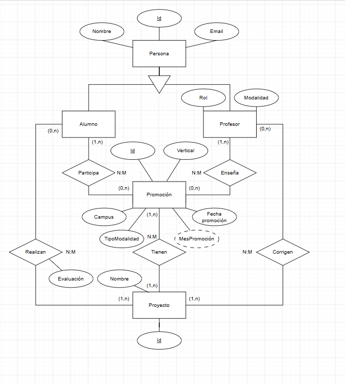
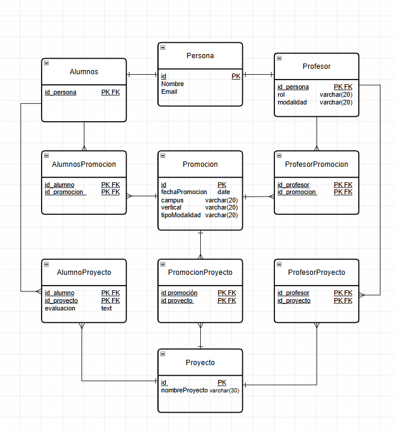

# Proyecto de Creación de una Base de Datos Relacional

Proyecto grupal del bootcamp de **The Bridge** (Data Science y Full Stack). Partimos de unos CSV sin normalizar con los alumnos y el claustro de varias promociones y los convertimos en una **base de datos relacional en PostgreSQL**, alojada en **Supabase**.

**Resultado:** 10 tablas en Tercera Forma Normal, con herencia entre persona, alumno y profesor, 500 filas cargadas y un conjunto de consultas de demostración.

## Equipo E

| Vertical | Nombre |
|---|---|
| DS | Noa |
| DS | Patricio |
| DS | Nicolás |
| DS | Paula |
| FS | Mariela Velasquez Canache |
| FS | Carlos Rodríguez Ruiz |

## Contenido del repositorio

```
├── enunciado/        Enunciado del proyecto
├── data/             CSV originales: clase_1 … clase_4 y claustro
├── diagramas/        Modelo E/R, modelo lógico, ingeniería inversa (Workbench) y esquema en Supabase
│   └── v1/           Diagramas de la primera versión del modelo
├── sql/
│   ├── mysql/        Script de creación y carga para MySQL Workbench
│   ├── postgresql/   Script de creación y carga para PostgreSQL (Supabase / Render)
│   ├── consultas_demo.sql
│   └── v1/           Scripts y consultas de la primera versión del modelo
├── python/           Carga alternativa de los CSV con pandas + SQLAlchemy
└── docs/
    ├── Proyecto_BBDD_Explicado.pdf   Memoria paso a paso (primera versión del modelo)
    ├── Presentacion.pptx             Presentación técnica
    └── capturas/                     Capturas de los scripts, Supabase y Python
```

## Cómo lo hicimos

1. **Normalización y modelo E/R.** Partíamos de datos reales, así que normalizamos primero la tabla original (1FN, 2FN y 3FN) y de ahí salieron las entidades. Como alumnos y profesores comparten nombre y email, los generalizamos en **Persona**, de la que heredan **Alumno** y **Profesor**.
2. **Modelo lógico.** Cada entidad es una tabla; cada subclase, una tabla cuya clave es el id de persona (PK y FK a la vez); y cada relación N:M, una tabla intermedia. En total, 3 + 2 + 5 = 10 tablas.
3. **Verificación de la normalización** sobre las tablas finales.
4. **Creación de la base de datos.** Primero en MySQL Workbench y después traducida a PostgreSQL para Supabase.



| Tabla | Qué guarda | Filas |
|---|---|---|
| `persona` | Nombre y email de alumnos y profesores | 62 |
| `alumnos` | Subclase de persona | 52 |
| `profesor` | Subclase de persona, con rol y modalidad | 10 |
| `promocion` | Fecha, campus, vertical y modalidad | 6 |
| `proyecto` | Nombre del proyecto | 10 |
| `alumnosPromocion` | Participa: alumno – promoción | 52 |
| `profesorPromocion` | Enseña: profesor – promoción | 10 |
| `alumnoProyecto` | Realizan: alumno – proyecto, con la evaluación | 260 |
| `promocionProyecto` | Tienen: promoción – proyecto | 20 |
| `profesorProyecto` | Corrigen: profesor – proyecto | 18 |



## Cómo reproducirlo

### PostgreSQL (Supabase o Render)
1. Crear un proyecto en [Supabase](https://supabase.com) y abrir **SQL Editor → New query**.
2. Pegar y ejecutar [`sql/postgresql/ProyectoGrupal_v2_PostgreSQL.sql`](sql/postgresql/ProyectoGrupal_v2_PostgreSQL.sql). Crea el esquema `v2` con las 10 tablas, carga los datos y muestra el recuento final.
3. Probar las consultas de [`sql/consultas_demo.sql`](sql/consultas_demo.sql).

El script se puede ejecutar varias veces: empieza borrando las tablas si ya existen. Las tablas van en el esquema `v2` para no chocar con las de la primera versión; en Table Editor y Schema Visualizer hay que elegir el esquema `v2`.

### MySQL Workbench
Ejecutar [`sql/mysql/ProyectoGrupal_v2_MySQL.sql`](sql/mysql/ProyectoGrupal_v2_MySQL.sql). Crea la base de datos `ProyectoGrupalV2` con las tablas y los datos.

### Carga con Python (alternativa investigada)
[`python/carga_alumnos_pandas.py`](python/carga_alumnos_pandas.py) lee los CSV con pandas y carga los alumnos en un SQLite local con `to_sql`. Es una prueba de concepto hecha con la primera versión del modelo (tabla `alumnos` con nombre y email); con el modelo actual esos datos irían a `persona`. Para hacerlo en Supabase bastaría cambiar la URL de `create_engine` por la de PostgreSQL.

```bash
pip install pandas sqlalchemy
python python/carga_alumnos_pandas.py
```

## Diferencias entre MySQL y PostgreSQL

| MySQL | PostgreSQL | Motivo |
|---|---|---|
| `AUTO_INCREMENT` | `GENERATED BY DEFAULT AS IDENTITY` | Numeración automática estándar |
| `ENUM('presencial','online')` | `VARCHAR(20) CHECK (modalidad IN (...))` | PostgreSQL no admite ENUM dentro de la tabla |
| `MONTH(fecha)` | `EXTRACT(MONTH FROM fecha)` | Para calcular el mes de la promoción |
| `CREATE DATABASE`, `USE` | `CREATE SCHEMA v2`, `SET search_path` | Supabase ya proporciona la base de datos |
| — | `BEGIN … COMMIT` | Si algo falla, no se queda nada a medias |
| — | `setval(...)` al final | Ajusta los contadores tras insertar los id a mano |

## Decisiones

- **Herencia parcial y solapada.** Parcial: puede haber personas que todavía no sean ni alumno ni profesor. Solapada: una persona puede ser las dos cosas, por ejemplo un alumno que hace de ayudante en otra promoción, sin repetir su nombre ni su email.
- **Todas las relaciones son N:M**, para que un alumno pueda hacer más de un bootcamp o un profesor corregir proyectos de varias promociones.
- **Corrigen** guarda quién corrige cada proyecto. En el primer modelo solo se podía suponer a partir de la promoción.
- **La modalidad está en el profesor y en la promoción**: en una misma promoción hay docentes presenciales y online.
- **MesPromoción es un atributo derivado**: no se guarda, se calcula a partir de la fecha.

## Datos que no venían en los CSV

- **Quién corrige cada proyecto.** Las 18 filas de `profesorProyecto` son **datos de ejemplo**: los TA corrigen los primeros proyectos de su vertical y los LI los más avanzados.
- **El email de los profesores** no viene en `claustro.csv`, así que queda vacío.
- **La modalidad de la promoción** no viene en ningún CSV; se ha supuesto `presencial` porque los alumnos tienen campus.
- `FullSatck` se ha mantenido tal como viene en los CSV de origen.

## Mejoras futuras

Una tabla `modalidad` (añadir "Híbrida" sería un simple INSERT), tablas propias para campus, vertical y aula, guardar quién corrige la entrega de cada alumno (un `id_profesor` en `alumnoProyecto`), más restricciones (`UNIQUE` en el email, `NOT NULL`, `CHECK` en la evaluación) y activar RLS en Supabase.
